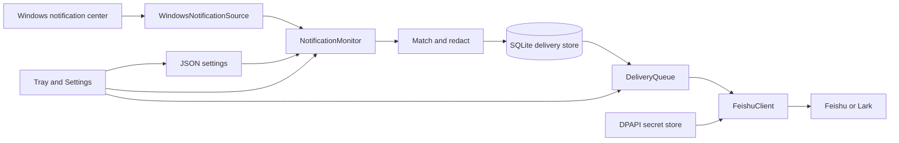
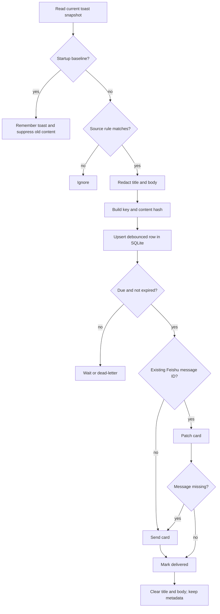
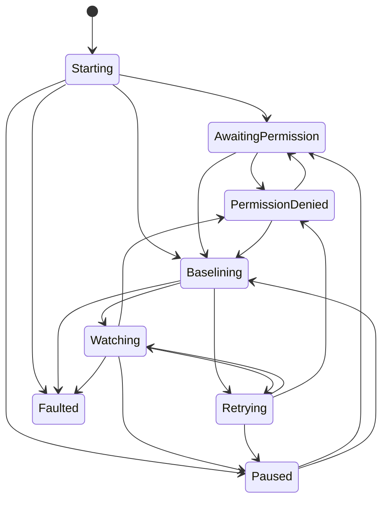
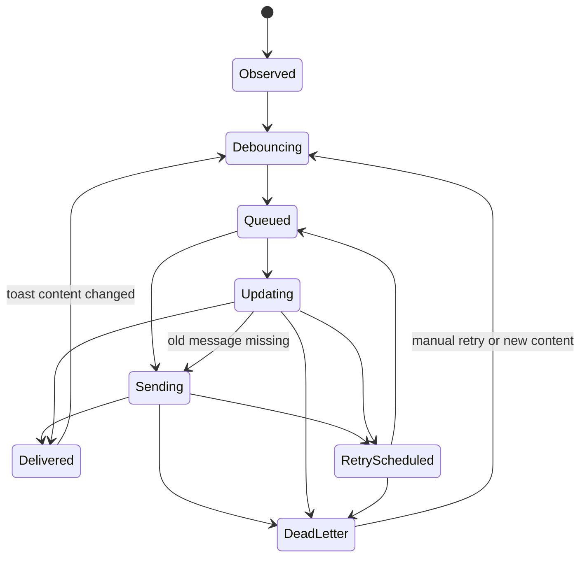
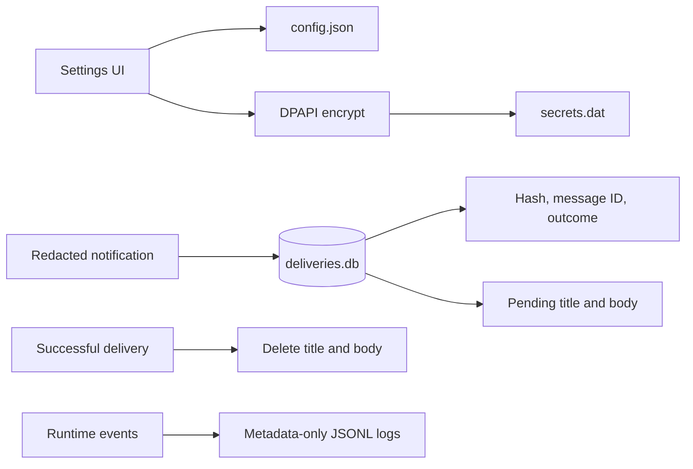

# Architecture

## Main Parts

- `WindowsNotificationSource` is the only code that calls `UserNotificationListener`.
- `NotificationMonitor` owns listener state, startup baseline, source matching, redaction, deduplication, and reconciliation.
- `DeliveryStore` persists work before network delivery and keeps restart state.
- `DeliveryQueue` owns expiry, retry, send, update, replacement, and retention behavior.
- `FeishuClient` owns tenant tokens and typed HTTP errors.
- `AppController` connects the tray, Settings window, listener, queue, and storage.

## Data Flow

Toast identity is `source AppUserModelID + Windows notification ID + creation time`. The content hash detects repeated snapshots and changed content. A one-second debounce keeps rapid changes in one row.

## Listener State

- `Baselining` records notifications already present at startup and never delivers them.
- `Watching` handles change events and also reconciles the full snapshot every 15 seconds.
- `PermissionDenied` is entered when access is missing or revoked.
- `Retrying` keeps the app alive after a temporary listener read failure.

## Delivery State

The `Queued` transition is validated before a row moves atomically to `Sending` or `Updating`. A newer toast revision can move an in-flight row back to `Debouncing`; completion of the older revision cannot erase the newer title/body.

## Files And Secrets

The App Secret is encrypted for the signed-in Windows user. Regex redaction runs before notification content enters SQLite, logs, or Feishu. Logs record keys, hashes, source names, outcomes, and message IDs, not notification bodies or credentials.

## Boundaries

- One Windows user and one Feishu/Lark destination.
- No notification deletion or modification.
- No direct Windows notification database access.
- No process scraping and no CLI-agent hooks.
- No inbound network listener, Feishu event subscription, or remote command path.
